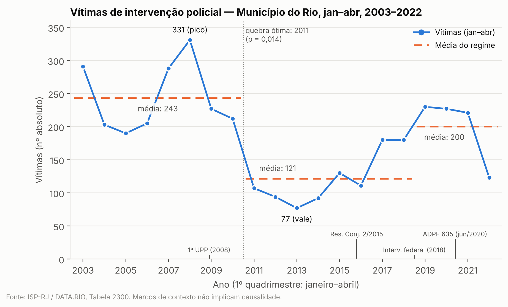

# Vítimas de intervenção policial no Rio de Janeiro (1º quadrimestre, 2003–2022)

[](LICENSE)
[](LICENSE-DATA.md)
[](#princípios-fair)


📄 **Artigo publicado:** <https://mi-gue-l.github.io/letalidade-policial-rio/>
(o código-fonte da página está em [`docs/index.html`](docs/index.html))

[](https://mi-gue-l.github.io/letalidade-policial-rio/)

Projeto final de **Linguagem de Programação (Análise e Visualização de Dados com Python)**, Bacharelado em Sistemas de Informação, 6º período, **Unilasalle RJ**.
**Autor:** Miguel Garcia Lopes do Amaral · **Professor:** Alexandre Neves Louzada

## Resumo executivo
Este projeto analisa a série oficial de vítimas de oposição à intervenção policial (antes chamadas “autos de resistência”) no Município do Rio de Janeiro, sempre no 1º quadrimestre (janeiro a abril), de 2003 a 2022. São só 20 observações, então a análise é cuidadosa com o que consegue afirmar. Três perguntas guiam o trabalho:

- **RQ1:** a série cai de forma contínua ou muda de patamar?
- **RQ2:** olhar a taxa por 100 mil habitantes, em vez da contagem, muda a leitura?
- **RQ3:** quais variações de um ano para o outro vão além do que o acaso explicaria?

O total cai de 291 para 123 (−57,7 %), mas não há uma tendência linear significativa. O que aparece é uma quebra de nível em 2011, um retorno a valores altos em 2019–2021 e um novo recuo em 2022. A taxa por 100 mil cai mais (−63,4 %) porque a população cresceu 15,6 %, mas conta a mesma história. Seis das 19 variações anuais superam o ruído esperado de contagens pequenas. Os dados são agregados e não permitem dizer o que causou cada mudança.

**Palavras-chave:** letalidade policial; Rio de Janeiro; séries temporais; análise exploratória de dados; dados abertos; FAIR.

## De onde vêm os dados
A tabela vem do portal DATA.RIO (Instituto Pereira Passos), que reúne números do Instituto de Segurança Pública do RJ (ISP-RJ):

- ISP-RJ: <http://www.ispdados.rj.gov.br/>
- DATA.RIO, Tabela 2300: <https://www.data.rio/> (o IPP consultou o ISP em 24/05/2022)

O arquivo original está em `data/raw/` e nunca é modificado (SHA-256 `179553629368d5962295634ed9eeb118cb0b1188d6ddf7f02a854182fa7b2d35`). O significado de cada coluna está em [`data/data_dictionary.md`](data/data_dictionary.md).

## O que tem aqui
```
data/raw/            planilha original
data/processed/      dados tratados (csv.gz e json), log do ETL e métricas
data/data_dictionary.md
notebooks/           análise exploratória, já executada
src/                 etl.py, analysis.py, figures.py e o gerador do artigo
tests/               testes automatizados
docs/                o artigo (GitHub Pages) e suas figuras
```

## Como rodar
Com Python 3.11 ou mais novo:

```bash
git clone https://github.com/Mi-gue-l/letalidade-policial-rio.git
cd letalidade-policial-rio
pip install -r requirements.txt
python -m src.etl && python -m src.analysis && python -m src.figures && python -m src.build_article
```

Para conferir tudo: `python -m unittest discover -s tests` e `python -m src.check_repo`. O notebook abre no JupyterLab; sem Jupyter, `python -m src.notebook_tools notebooks/analise_exploratoria.ipynb` reexecuta as células.

## Princípios FAIR
- **Localizável:** README com resumo, palavras-chave e fonte; `CITATION.cff`; autoria no cabeçalho de cada artefato.
- **Acessível:** repositório público, sem login para baixar ou rodar; artigo leve e responsivo, sem bibliotecas externas.
- **Interoperável:** dicionário de dados completo; dados em `.csv.gz` e `.json`.
- **Reutilizável:** licença MIT para o código e CC BY 4.0 para dados e texto; dependências com versão fixa; `etl_log.json` guarda os hashes e as regras aplicadas.

## Limitações
Só o 1º quadrimestre de cada ano, só o total do município, registros policiais cuja classificação pode mudar depois, e apenas 20 pontos. Os “patamares” foram identificados depois de olhar os dados. Nada aqui mede causa e efeito.

## Licenças
Código: [MIT](LICENSE). Dados tratados, figuras e texto: [CC BY 4.0](LICENSE-DATA.md). Os dados originais seguem os termos do ISP-RJ e do DATA.RIO.
